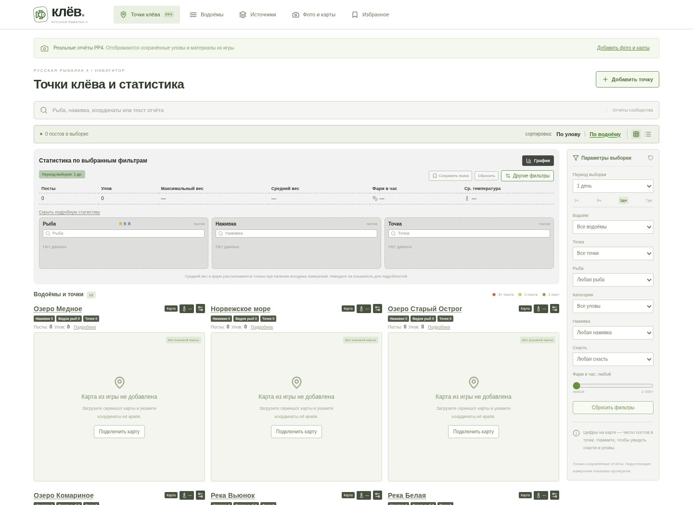
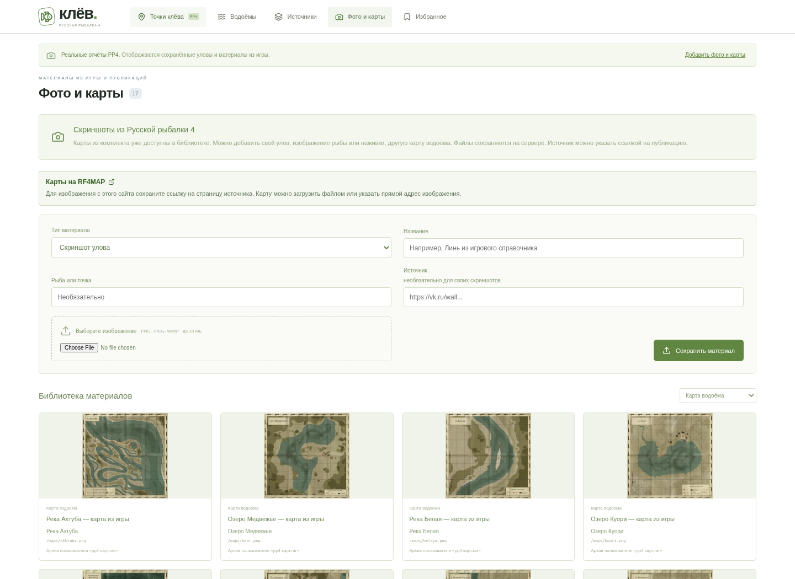

# Клёв — навигатор Русской рыбалки 4

Русскоязычный сайт с точками клёва, фильтрами по водоёму, рыбе, снасти и дате, избранным, отчётами сообщества и импортом источников. По умолчанию используются только сохранённые отчёты: вымышленные уловы и рисованные заменители игровых карт/рыб не показываются. На новой установке база уловов пуста до добавления или импорта данных.

## Запуск

Нужен Node.js 22.13+ (проверено на 24.19) и npm.

На своём компьютере распакуйте ZIP из GitHub и откройте терминал в папке, где лежит `package.json`:

```sh
npm ci
npm run dev
```

Откройте адрес, который Vite напечатает в терминале. В облачном окружении папка проекта — `/workspace/rr4`; для установки там используется `npm ci --cache /workspace/.npm-cache`.

Vite запускает интерфейс на порту 5173, Express API — на 3001. Для собранной версии:

```sh
npm run build
npm start
```

Собранный интерфейс и API обслуживаются одним процессом на порту `PORT` (по умолчанию 3001). Проверка готовности: `GET /api/health` возвращает `{"status":"ok","database":"sqlite"}`. Работающие процессы нужно запускать заново после восстановления облачного окружения.

## Что работает

- Компактный интерфейс статистики по образцу предоставленных скриншотов: сводка, списки рыб/наживок/точек, фильтры справа и сетка карт. Каталог из 12 водоёмов, включая Медное и Норвежское море.
- Метки объединяют посты с одинаковыми координатами на одном водоёме. Цвет отражает количество постов: зелёный — 1, жёлтый — 2, красный — 3 и больше. Нажатие открывает прокручиваемое окно со статистикой точки и отчётами в две колонки.
- Карты можно увеличивать, уменьшать и перемещать после увеличения. **Рисованные схемы удалены.** Настоящее изображение можно загрузить файлом или указать по HTTPS-ссылке; координатные границы задаются в настройках карты. Пока карты нет, доступны численные точки без выдуманного расположения.
- Фильтры по периоду, водоёму, рыбе, наживке, снасти, категории, клипсе и минимальному фарму; поиск по тексту. Нажатия в сводной статистике применяют фильтры. Есть лента публикаций, график активности и сохранённые поиски в браузере.
- Карточки улова показывают снасть, количество рыб, вес, автора, клипсу, глубину, температуру, доход и источник при наличии данных. Скриншоты можно загрузить с компьютера или указать HTTPS-ссылками и открыть крупно.
- Избранное в localStorage браузера.
- Добавление отчёта, проверка полей, ссылка на публикацию, постоянное хранение в SQLite.
- Импорт открытого JSON, RSS/Atom; проверка данных, сохранение ссылки на первоисточник, удаление дубликатов, счётчик пропущенных записей.
- Адаптер официального VK API `wall.get` для открытой стены сообщества. Он читает последние 100 публикаций, а не всю историю. Неполные или нераспознанные сообщения пропускаются.
- Обновление подключённых лент через 5 секунд после старта и каждые 30 минут, а также по кнопке. Сайты без адаптера и VK без токена пропускаются. Одновременные обновления одного источника блокируются.
- Раздел «Фото и карты»: загрузка своих PNG/JPEG/WebP, библиотека материалов с источниками, привязка изображения к точному названию рыбы или наживки. Тип определяется по содержимому файла, максимум 10 МБ на файл; SVG/HTML не принимаются.
- VK-адаптер сохраняет фото-вложения, включая репосты, выбирая самое крупное изображение. При повторном импорте ссылки на фото обновляются без дублирования отчёта.
- В комплекте есть оригинальный скриншот карточек RealShrimp 6.5 - 06 и два значка интерфейса РР4. Это справочный материал, не вымышленный улов. Источник, версия и контрольные суммы — в THIRD_PARTY_NOTICES.md и public/game-assets/provenance.json. Полного набора оригинальных карт и изображений рыб пока нет.
- Тестовые отчёты доступны только при явном ALLOW_DEMO_DATA=1 и адресе с ?demo=true. В обычном интерфейсе переключателя на них нет. В рабочем окружении оставьте переменную не заданной.

## Статистика и карты

Посты — количество отчётов в выборке; улов — сумма `catches`. Максимальный вес берётся из `maxWeightGrams` или поля `weight` с единицей г/кг. Средний вес вычисляется как сумма `totalWeightGrams`, делённая на сумму `catches` **только по отчётам, в которых указан суммарный вес**. Максимальные веса не подменяют средние.

Фарм в час = сумма `silver` × 60 / сумма `durationMinutes` только по отчётам с обоими значениями. Это взвешенный по длительности результат. Средняя температура берётся по отчётам с `temperatureC`. Если данных нет, показан прочерк. Подсказки у среднего веса и фарма показывают покрытие исходными измерениями. График группирует публикации в 12 интервалов выбранного периода.

В форме отчёта раскройте «Статистика и снасть — необязательно». Для JSON-источников поддерживаются дополнительные поля:

```json
{
  "maxWeightGrams": 627,
  "totalWeightGrams": 3500,
  "silver": 604,
  "durationMinutes": 60,
  "temperatureC": 8.2,
  "depthM": 25,
  "clip": "25",
  "quality": "trophy",
  "pointLabel": "34",
  "images": ["https://example.com/catch.jpg"]
}
```

`quality`: `normal`, `trophy`, `rare`, `record`. До 8 изображений на отчёт. `pointLabel` — подпись точки; фактический ключ группировки всегда состоит из `waterId`, `x`, `y`, поэтому одноимённые точки разных водоёмов не объединяются.

Для настоящей карты нажмите кнопку настроек у названия водоёма. Загрузите собственный скриншот карты кнопкой «Загрузить файл карты», выберите уже загруженную карту из библиотеки или укажите HTTPS-изображение. Ссылка на страницу сайта и прямой адрес изображения — разные поля: страницу первоисточника укажите отдельно, она появится под картой и сохранится после перезапуска. По умолчанию карта сохраняется для просмотра без координатной привязки: доступны увеличение и перемещение, отчёты открываются из списка координат под картой. Пропорции изображения сохраняются. Буквенная сетка A–J и строки 1–10 сами по себе не определяют игровые координаты.

Чтобы включить метки, отметьте «Наложить точки по игровым координатам» и задайте реальные X левого/правого краёв изображения, минимум/максимум Y и направление вертикальной оси. Все четыре границы обязательны; приложение не подставляет предполагаемые значения. Изображение должно соответствовать этим границам. Настройка сохраняется в SQLite для этого экземпляра сайта. Метки вне границ не показываются. Если изображение недоступно, остаётся список координат. Сохранённые ранее карты с полными границами работают как прежде. Настройку можно удалить кнопкой «Отключить карту».

В API режим просмотра задаётся явно: `PUT /api/maps/amber` с телом `{ "url": "/maps/amber.png", "calibrated": false }`. Для наложения меток передайте `calibrated: true` и все поля `minX`, `maxX`, `minY`, `maxY`, `flipY`. Старый формат с полными границами без поля `calibrated` по-прежнему принимается.

Локальные изображения также поддерживаются: поместите файл в `public/maps/` и укажите путь `/maps/имя-файла.jpg` латиницей. Vite скопирует файл в сборку при `npm run build`. Готовый комплект игровых карт в проект не включён. Загруженные файлы сохраняются в data/media/; при переносе сайта нужно сохранить их вместе с базой SQLite.

Сохранённые поиски и избранное хранятся в конкретном браузере. Кнопка «Поделиться выборкой» копирует адрес этого экземпляра сайта с параметрами водоёма, точки и фильтров; она не публикует сайт.

## Вид интерфейса

Снимки ниже показывают обычный режим: пустую начальную базу отчётов и библиотеку с найденным оригинальным игровым изображением. Пустые данные не подменяются придуманными уловами.





## Выбранные источники и ограничения

При первом запуске регистрируются:

1. `https://www.rf4-stat.ru/` — сохранён как сайт **без сборщика**. Проверка 23 октября 2026 года вернула HTTP 403 со страницей «Проверка безопасности» и просьбой подтвердить, что посетитель — человек. Структура данных и разрешённый способ экспорта не проверены; адаптер не написан и реальные данные не импортированы.
2. `https://vk.ru/pp4wikipedia` — подготовлен адаптер VK API. **Реальное чтение пока не проверено: токен VK не предоставлен.** Тесты проверяют адаптер на фикстурах, а не на живой стене сообщества.

Пользователь также указал `https://rf4map.ru/` как источник карт. Ссылка доступна в настройках карты, библиотеке материалов и рекомендациях источников. **Содержимое не проверено и карты не скачаны:** 23 октября 2026 года сетевой прокси этой облачной сессии отклонил HTTPS CONNECT с кодом 403 для `rf4map.ru` и `www.rf4map.ru`, до получения ответа от сайта. Это не свидетельствует о блокировке со стороны RF4MAP. Адаптер/API не подтверждены, автосбор не подключён. Домены добавлены в сетевой черновик окружения; для применения нужно сохранить и опубликовать окружение через его настройки. После появления доступа следует проверить структуру и условия использования оригинальных материалов, затем подключить проверенные изображения с реальными границами координат. Не подменяйте их вымышленными картами.

Для VK задайте `VK_ACCESS_TOKEN` через защищённые настройки окружения. Нужен токен, с которым VK разрешает `wall.get` выбранного сообщества; доступ зависит от типа токена и актуальных ограничений VK. Не отправляйте токен в чат, не помещайте в URL или Git. Для локальной разработки можно скопировать `.env.example` в игнорируемый `.env`; приложение читает его через Node.js. Затем перезапустите сервер и нажмите «Обновить» в источниках. Ошибки доступа отображаются в статусе источника.

Нужные сетевые назначения: `registry.npmjs.org`, `www.rf4-stat.ru`, `rf4-stat.ru`, `rf4map.ru`, `www.rf4map.ru`, `vk.ru`, `www.vk.ru`, `api.vk.com`, а для RSS/JSON — домен конкретной ленты. Настройки доменов и секретов сохранены отдельно в черновике облачного окружения; сохранение черновика не применяет их к текущему процессу.

Если в окружении задан HTTPS_PROXY, добавляйте домены дополнительных лент в переменную FEED_ALLOWED_HOSTS (через запятую) и сетевой список разрешений. В этом режиме DNS выполняет управляемый прокси; приложение допускает только точно перечисленные администратором публичные домены. На обычной машине без прокси приложение проверяет публичные IP и фиксирует DNS при подключении. Проверка HTTPS-загрузчика через сетевой прокси выполнена на публичном JSON npm registry; это не является проверкой импорта реальных рыболовных отчётов.

Произвольные сайты не превращаются в источники автоматически. Для каждого формата нужен разрешённый API, RSS/JSON или отдельный проверенный адаптер. Закрытые группы, обход защиты, извлечение из изображений и видео, историческая выгрузка не реализованы. Наложение точек на загруженную игровую карту работает по заданным пользователем границам.

## Формат JSON

Добавьте публичный HTTPS-адрес в разделе «Источники», выберите JSON и нажмите «Обновить». Принимается массив или объект с полем `reports`:

```json
{
  "reports": [
    {
      "waterId": "old-burg",
      "fish": "Линь",
      "x": 47,
      "y": 20,
      "bait": "Творожное тесто",
      "tackle": "Донная",
      "weight": "4,8 кг",
      "catches": 7,
      "author": "Имя рыболова",
      "note": "Дистанция, клипса и прикормка",
      "sourceUrl": "https://example.com/posts/123",
      "publishedAt": "2026-10-22T10:00:00.000Z"
    }
  ]
}
```

Поля `waterId`, `fish`, `x`, `y`, `bait`, `tackle` обязательны. `catches` по умолчанию 1; если дата отсутствует, используется время импорта. Допустимые значения снасти: `Донная`, `Поплавочная`, `Спиннинговая`. Идентификаторы водоёмов возвращает `GET /api/catalog`. Максимум 500 записей и 2 МБ на загрузку, тайм-аут 15 секунд на запрос. Дубликат определяется по источнику, ссылке, водоёму, рыбе, координатам, наживке и календарной дате UTC.

## Формат RSS / Atom и сообщений VK

Название водоёма и координаты должны быть в тексте. Пример описания публикации:

```text
Озеро Старый Острог 47:20
Рыба: Линь | Наживка: Творожное тесто | Снасть: Донная
```

RSS поддерживает теги `title`, `description`, `link`, `pubDate`; Atom — `title`, `summary`/`content`, `link href`, `published`/`updated`. Для VK допускаются отдельные строки, поля `Насадка` и `Приманка`, известное название рыбы и распознаваемое упоминание снасти. Отчёты без необходимых данных пропускаются, без выдумывания недостающих значений.

## Хранение и API

`data/klev.sqlite` (и WAL-файлы рядом) создаётся автоматически. Путь можно переопределить через `DATA_DIR`. Для сохранения отчётов после развёртывания используйте постоянный диск и резервные копии SQLite. Удаление источника не удаляет уже импортированные отчёты. Тестовые точки не хранятся в базе. Токен VK в базе не хранится. Локальные изображения лежат в data/media/ (игнорируются Git), их метаданные и источники — в SQLite. Удаление изображения из формы убирает только ссылку; файл остаётся в библиотеке, чтобы не сломать другие отчёты. Встроенный оригинальный скриншот приманки хранится в public/game-assets/ с указанием источника.

| Метод      | Путь                     | Назначение                                   |
| ---------- | ------------------------ | -------------------------------------------- |
| GET        | `/api/health`            | Готовность сервера                           |
| GET        | `/api/catalog`           | Водоёмы и рыбы                               |
| GET        | `/api/reports`           | Реальные отчёты                              |
| GET        | `/api/reports?demo=true` | Только тестовые данные при ALLOW_DEMO_DATA=1 |
| POST       | `/api/reports`           | Добавить реальный отчёт                      |
| GET / POST | `/api/sources`           | Источники                                    |
| POST       | `/api/sources/:id/sync`  | Обновить источник                            |
| DELETE     | `/api/sources/:id`       | Удалить источник                             |
| GET        | `/api/maps`              | Сохранённые карты водоёмов                   |
| PUT        | `/api/maps/:waterId`     | Изображение и координатные границы карты     |
| DELETE     | `/api/maps/:waterId`     | Отключить карту                              |

| GET | `/api/media` | Библиотека изображений с источниками |
| POST | `/api/media` | Multipart-загрузка: file, kind, label, entity, sourceUrl |
| GET | `/media/:id.ext` | Загруженное изображение с правильным MIME и nosniff |

Сейчас это версия для разработки с общим каталогом без аккаунтов. Перед публичным запуском нужны авторизация для управления источниками, модерация отчётов, ограничения запросов, резервные копии и настройки развёртывания. Базовая защита импорта блокирует внутренние IP, проверяет DNS и перенаправления и сохраняет проверку TLS. JSON API отклоняет запись с чужого Origin, но это не заменяет авторизацию. Ссылки и текст публикаций обрабатываются как данные; HTML из источников не исполняется.

## Проверки

```sh
npm run build
npm test
npm run test:e2e
npm audit --audit-level=high --cache /workspace/.npm-cache
```

Тесты изображений используют техническое изображение 1×1 пиксель в отдельной временной базе; оно не включается в обычные данные сайта и не выдаётся за игровой материал.

Браузерные тесты используют установленный `/usr/bin/chromium`. Для другой системы задайте `CHROMIUM_PATH`. Тестовый сервер запускается на 3101 с отдельной временной SQLite-базой и без VK-токена. Проверяются поиск, фильтры, избранное, форма реального отчёта, сохранение после перезагрузки, источники, отклонение внутренних адресов, чужого Origin и мобильная навигация. Серверные тесты проверяют JSON/RSS/Atom/VK, пропуски, дубликаты и ограничения импорта.
